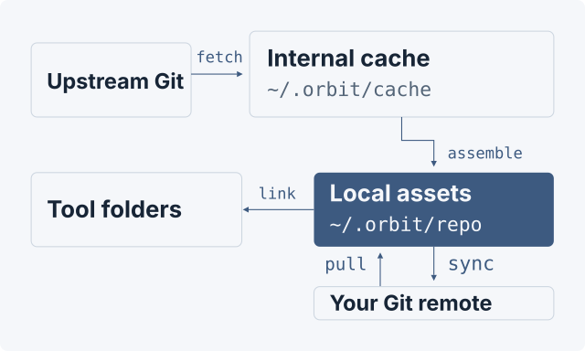

# Orbit CLI

**One YAML file to distribute Git-backed assets across your developer tools.**

English · [简体中文](README.zh-CN.md)

Go 1.26 / 1.27 · System Git · Declarative configuration

[Quick start](#quick-start) · [Commands](#commands) · [Configuration](#configuration-reference) · [Publish to GitHub](#publish-to-github) · [Axon migration checks](#check-and-repair-an-axon-migration)

## Overview

Orbit helps developers reuse **skills, workflows, scripts, and commands** across tools and projects. `orbit vendor sync` downloads upstream assets into `~/.orbit/repo`, `orbit link` distributes them through symlinks, and `orbit sync` commits and pushes the local assets to your personal Git repository.

## Example output

Example session from an isolated local Git repository, with the local repository path abbreviated. Two tools' `skill-creator` links resolve to the same assembled directory.

```console
$ orbit vendor sync
synced skill-creator
assembled 1 dependencies into <local-repo>
$ orbit link
$ orbit check
{
  "issues": [],
  "status": "ok",
  "verification": "clean cache and configured symlink destinations"
}
```

## How it works



`vendor sync` downloads and assembles assets locally without committing or pushing. `link` creates or removes tool links. `sync` commits and pushes local assets without downloading upstream or overwriting local content from the cache. Nothing writes back to upstream.

## Quick start

Install with [Homebrew](https://brew.sh) on macOS (Apple Silicon / Intel) or Linux amd64:

```sh
brew install HuangChenning/tap/orbit
orbit --version
orbit init
```

The [personal tap](https://github.com/HuangChenning/homebrew-tap) installs the published binary and verifies its SHA256. Go and Python are not required. macOS requires version 13 or newer. Configuration and assets still default to `~/.orbit`; Homebrew manages the executable. To upgrade, run `brew update` followed by `brew upgrade HuangChenning/tap/orbit`, rather than `orbit update`.

If you previously installed Orbit manually, check `command -v orbit`: an earlier directory in PATH may select that copy. Check the Homebrew copy directly with `"$(brew --prefix orbit)/bin/orbit" --version`, then adjust your PATH to select the installation you want to use.

Alternatively, ensure **Git is on your PATH** and build from source on macOS / Linux. Source builds require Go 1.26 or 1.27 (CI pins 1.26.10 and 1.27.3):

```sh
git clone https://github.com/HuangChenning/orbit-cli.git
cd orbit-cli
mkdir -p "$HOME/.orbit/bin"
go build -o "$HOME/.orbit/bin/orbit" ./src
export PATH="$HOME/.orbit/bin:$PATH"
orbit init
```

For source installations, add the PATH setting to your shell startup file to make it persistent. By default, `orbit init` creates `~/.orbit/orbit.yaml` without overwriting an existing configuration.

Create your personal remote repository, then edit this file. Replace `YOUR_ACCOUNT` with your account and declare your first dependency:

```yaml
version: "1.0"
global_cache: "~/.orbit/cache"

orbit_repo:
  remote: "git@github.com:YOUR_ACCOUNT/orbit-repo.git"
  branch: "main"
  local_path: "~/.orbit/repo"

link_targets:
  skills:
    - "~/.claude/skills"
    - "~/.codex/skills"

dependencies:
  - name: "skill-creator"
    source: "https://github.com/anthropics/skills.git"
    ref: "refs/heads/main"
    subdir: "skills/skill-creator"
    mirror_dir: "skills/skill-creator"
    vendor: true
    link: true
    labels:
      - skills
```

Then run:

```sh
orbit vendor sync
orbit link
orbit check
```

The downloaded files appear in `~/.orbit/repo/skills/skill-creator`. This example links that directory to `~/.claude/skills/skill-creator` and `~/.codex/skills/skill-creator`. If a real file, directory, or symlinked parent directory occupies a destination, resolve the conflict manually first.

## Commands

| Command | Purpose | Common options |
| --- | --- | --- |
| `orbit update check` | Check the latest stable GitHub Release | No asset configuration required |
| `orbit update` | Download, verify SHA256 and replace the current program | No asset configuration required |
| `orbit init` | Generate configuration without overwriting an existing file | `--path <dir>` |
| `orbit vendor sync` | Download upstream and assemble local assets | `--name <name>` / `--label <label>`, `--jobs <n>` |
| `orbit link` | Create or remove matching links according to the `link` switch | `--name <name>` / `--label <label>`, `--force` |
| `orbit sync` | Commit and push local assets to your personal remote | `--name <name>` / `--label <label>`, `--message <text>` |
| `orbit check` | Check the cache and enabled links, or inspect duplicate selections | `--duplicates`; `--fix` with explicit Axon inputs |
| `orbit clean` | Preview and confirm deletion of selected managed caches | `--name <name>` / `--label <label>`, `--yes` |

Use `--name` for exact asset names or `--label` for optional groups; the two flags are mutually exclusive. Both accept English-comma lists and repeated flags, trim surrounding whitespace, deduplicate values and use **OR** matching. Names and labels are case-sensitive. Unknown names, no matching labels, empty list items and Chinese commas (`，`) are errors. Selection also applies to `link`, `sync`, `check` and `clean`; explicit Axon coverage checks/repairs always compare the full configuration. Vendor downloads run at most 4 concurrent Git operations by default. Each Git operation has a two-minute timeout, adjustable with `--timeout`.

`link` prints the selected configuration, per-asset action counts and a final summary: created, replaced, unchanged, removed, preserved, absent or failed. `sync` prints asset validation, the new commit ID or a no-local-changes message, push progress and success. An unchanged snapshot still retries the push of an existing commit. Failures return a nonzero exit code.

Vendor downloads fetch a shallow snapshot of the configured Git ref, rather than every upstream branch and its full history. The cache is internal; use the assembled files under `~/.orbit/repo`.

```sh
# Replace these asset names with names from your configuration.
orbit vendor sync --name core-skill,go-review
orbit vendor sync --name core-skill --name go-review
orbit vendor sync --label skills,workflows --jobs 4
```

### Clean downloaded caches

Run `orbit link` first if tool links still point to the old cache location. Then remove the managed caches for all dependencies in the current configuration:

```sh
orbit clean
```

The command lists the selected dependencies and asks for confirmation. Use `orbit clean --yes` to skip confirmation, or `orbit clean --label skills` to select a group. No `--all` flag is needed or supported. Caches no longer declared in the configuration are not selected.

Cleanup preserves assembled assets in `~/.orbit/repo` and links pointing there. `orbit sync` can still commit and push those assets without a cache; the next `orbit vendor sync` downloads the removed caches again and refreshes the selected local assets.

## Directories and configuration

In the source repository, Go code lives in `src/main.go` and `src/internal/`. You can keep project skills locally under the root `internal/skills/` directory; the entire root `internal/` directory is ignored by Git. `go.mod` and `go.sum` remain at the repository root; run build commands from there, using `go build -o orbit ./src` or `go run ./src --help`.

| Default path | Purpose |
| --- | --- |
| `~/.orbit/bin/orbit` | Binary built by the installation steps above |
| `~/.orbit/orbit.yaml` | Global configuration |
| `~/.orbit/cache` | Git cache shared by source and version |
| `~/.orbit/repo` | Downloaded assets under `skills/`, `workflows/`, `scripts/`, and `commands/`, according to `mirror_dir` |

Asset commands default to `~/.orbit/orbit.yaml`. Project and parent-directory files do not override it. Use `orbit --config ./orbit.yaml link` to select another file explicitly. Relative paths resolve from the selected configuration file's directory. Paths starting with `~/` are supported.

Declare tool root directories once in the global `link_targets`, grouped by category. Each dependency uses a `link` switch. The first segment of `mirror_dir` selects the category; the remaining path is appended to each tool root.

After changing an existing dependency's `link` to `false`, run `orbit link` again to remove symlinks at the current destinations that still point to that dependency's local asset directory, including dangling links. Matching links to the old cache location are also removed. Cache contents, local assets, real files, directories, and links pointing elsewhere are preserved. Cleanup works even when the cache is missing and respects `--label`. Old links at destinations no longer present in the configuration require manual handling.

## Configuration reference

`orbit.yaml` contains exactly one YAML mapping. Unknown fields, duplicate keys and incorrect types are rejected. Quote string versions such as `"1.0"`; use YAML booleans `true` / `false` for switches. These settings describe assets; `--jobs`, `--timeout` and `--message` are command-line flags, not YAML fields.

### Top-level fields

| Field | Type | Required / default | Meaning |
| --- | --- | --- | --- |
| `version` | string | Required; exactly `"1.0"` | Configuration format version, separate from the Orbit program version and each upstream dependency's version. |
| `global_cache` | string path | Required; no automatic default | Internal Git cache root. The generated template uses `~/.orbit/cache`; downloaded assets for use by tools are assembled under `orbit_repo.local_path`. |
| `orbit_repo` | mapping | Optional when parsing; required for `vendor sync`, `sync`, and creating enabled asset links | Personal Git repository settings, detailed below. Cache checks/cleanup can use a configuration without this section. |
| `link_targets` | mapping of category to string-path list | Optional; no targets by default | Declare tool root directories once per category. Typical categories are `skills`, `workflows`, `scripts` and `commands`; custom single-component category names are also supported. Each enabled dependency needs at least one target for its category. |
| `dependencies` | list of mappings | Optional; defaults to an empty list | Upstream assets to download, assemble, link and publish. Use `[]` for an initially empty configuration. |

### Personal repository: `orbit_repo`

| Field | Type | Required / default | Meaning |
| --- | --- | --- | --- |
| `remote` | string | Required when `orbit_repo` is present | Personal Git remote, for example `git@github.com:YOUR_ACCOUNT/orbit-repo.git` or an HTTPS URL. Passed to Git as supplied; for a local remote, use an absolute path rather than relying on Orbit to expand `~` or a relative path. |
| `branch` | string | Required; no default | Personal destination branch name, for example `main`. Use the branch name rather than `refs/heads/main`; this field does not select an upstream dependency's version. |
| `local_path` | string path | Defaults to `~/.orbit/repo` when omitted or empty | Local checkout containing assembled assets and `.orbit-manifest.yaml`. This is separate from the internal cache. |

The remote must already exist and Git must have access to it. Vendor sync may clone it to preserve existing history and unmanaged files, but does not commit or push; `orbit sync` publishes local managed assets.

### Upstream assets: `dependencies[]`

| Field | Type | Required / default | Meaning |
| --- | --- | --- | --- |
| `name` | string | Required, nonempty and unique | Asset identifier used in reports and the manifest. Storage and link destinations are selected by `mirror_dir`, not by this name. |
| `source` | string | Required, nonempty | Upstream Git HTTPS/SSH URL or local repository path. A relative local path such as `./vendor/example` resolves from the configuration directory; `~/...` is supported for local paths. |
| `ref` | string | Required; no default | Upstream branch, tag or full 40-character commit SHA. Prefer `refs/heads/main` for a branch and `refs/tags/v1.2.3` for a tag. Short branch/tag names are accepted unless ambiguous; a branch and tag with the same name cause an error. Branches follow updates, commit SHAs pin content, and changed cached tags are rejected. |
| `subdir` | string relative path | Defaults to `.` when omitted or empty | Directory to select inside the upstream checkout, for example `skills/skill-creator`. `.` selects the whole repository. This must identify a directory, not an individual file. |
| `mirror_dir` | string relative path | Optional; required when `link: true` | Destination inside the personal local repo, for example `skills/skill-creator`. Omit it to download this dependency into the cache only. Its first path component selects the link category. |
| `vendor` | boolean | Defaults to `true` | Whether `orbit vendor sync` downloads and assembles this asset. `false` skips it, preserving existing local files and manifest entries even during full refreshes. It does not disable linking or `orbit sync` publication. Explicit `--name` does not override this switch. |
| `link` | boolean | Defaults to `false` | Whether `orbit link` should create links for this asset. `false` preserves download/publication behavior and removes matching previously owned links when `orbit link` is run; it does not delete asset files. |
| `labels` | list of strings | Defaults to `[]`; entries must be nonempty | Explicit grouping tags, for example `["core", "backend"]`. Labels are not inferred from `mirror_dir` or category. Without `--name` or `--label`, commands select all dependencies. `--label core,backend` selects the union of exact matches; repeated flags also work. No match is an error. Labels are optional and appear last, after `vendor` and `link`; block-style lists and inline lists are equivalent. |

Legacy dependency `version` remains accepted as an alias for `ref`; specifying both keys is an error, even if one is empty. Generated/repaired entries use `ref`. The top-level `version: "1.0"` still describes the YAML format. Existing cache identities and manifest provenance remain compatible.

A disabled vendor can still use `link: true` when its managed local asset already exists. Missing local assets cause a clear link error. Operational `orbit check` skips cache validation for disabled vendors and still checks their enabled links.

### Paths and link mapping

Orbit expands `~` / `~/...` in filesystem settings (`global_cache`, `orbit_repo.local_path`, `link_targets` values and local dependency paths); `~otheruser` and shell-variable expansion such as `$HOME` are not supported. Relative filesystem paths resolve from the directory containing `orbit.yaml`, not the terminal's working directory. Git remote strings follow the `remote` rule above. On Windows, prefer forward slashes or single-quoted YAML paths to avoid backslash escape sequences.

`subdir` and `mirror_dir` are paths within repositories: no absolute paths, `~`, `..` components, `.git` components or `.orbit-manifest.yaml` components. `subdir` may be `.`, but `mirror_dir` must name a non-root destination. Separate dependencies' `mirror_dir` values cannot be equal or nested. Category names must be single safe relative path components.

Cache and local repo roots cannot overlap or be the filesystem root or home directory; their existing ancestors cannot be symlinks. Computed enabled link destinations must not overlap managed storage or each other, and must not be the filesystem root or home directory. At link time, real files/directories and symlinked parents are protected even with `--force`.

With the other top-level settings already configured, this excerpt links one asset to two tools:

```yaml
link_targets:
  skills:
    - "~/.claude/skills"
    - "~/.codex/skills"

dependencies:
  - name: "core-skill"
    source: "https://github.com/anthropics/skills.git"
    ref: "refs/heads/main"
    subdir: "skills/skill-creator"
    mirror_dir: "skills/core-skill"
    vendor: true
    link: true
    labels:
      - core
      - backend
```

The selected upstream directory is assembled into `~/.orbit/repo/skills/core-skill` when using the default `local_path`. `orbit link` maps it to both `~/.claude/skills/core-skill` and `~/.codex/skills/core-skill`. The suffix after `skills/` is appended to each tool root. For multiple skills, use distinct destinations such as `skills/core-skill` and `skills/another-skill` rather than assigning both to `skills`.

Dependencies with the same `source` and `ref` share one cache even when their names or subdirectories differ. Labels select dependencies, not separate cache copies: cleaning a selected shared cache also removes that cache for unselected dependencies sharing it. Assembled repo assets and links to them remain available.

## Publish to GitHub

The `orbit_repo` section specifies your personal remote and local asset directory. Ensure the remote exists and your Git credentials work:

```yaml
orbit_repo:
  remote: "git@github.com:YOUR_ACCOUNT/orbit-repo.git"
  branch: "main"
  local_path: "~/.orbit/repo"
```

You can omit `local_path`; it defaults to `~/.orbit/repo`. After downloading and reviewing your local assets, publish them with:

```sh
orbit sync
```

- `vendor sync` prepares all selected assets before replacing managed directories. Failed downloads or copy validation leave the previous assembled assets intact. A full vendor refresh removes only stale assets previously managed by Orbit and preserves assets with `vendor: false`; name/label-filtered refreshes preserve unselected assets. Local edits in refreshed assets are discarded to match upstream.
- The first vendor operation may clone your personal remote to preserve its history and unmanaged files such as a README. It creates no commit and performs no push. Later downloads do not publish pending local changes.
- Vendor assembly excludes nested `.git` entries and applies Gitignore-style rules from the `.orbitignore` beside your configuration. Internal relative symlinks are preserved; absolute or escaping links are rejected. `.env` is not implicitly excluded. Publication rejects nested Git repositories added locally.
- `sync` publishes the current managed local assets, including your edits, without requiring the cache or contacting upstream dependencies. Unmanaged working-tree changes and existing staged changes must be handled manually. An untracked `.DS_Store` at the repository root is preserved without being published, even when Git ignores it; tracked or staged changes to it still require manual handling. `--name` or `--label` stages only selected assets and their manifest entries, leaving other local changes pending.
- `.orbit-manifest.yaml` records upstream sources and resolved commits used for assembly; it does not claim that later local edits match those commits. Unchanged content produces no empty commit. A failed push retains the local commit for retry. Git attributes or filters that transform asset bytes cause publication to fail and clear its staging changes while preserving local files.

## Check duplicate selections

```sh
orbit check --duplicates
orbit check --duplicates --name core-skill,go-review
```

This read-only JSON report lists repeated `source`/`ref`/`subdir` selections, nested selections from the same source/ref, repeated skill names and identical `SKILL.md` bytes across configured assets. Names come from YAML frontmatter, falling back to the containing folder. Matching bytes describe that file only; they do not prove that complete skill directories are equivalent. Unknown fields, duplicate YAML keys and duplicate dependency names remain configuration errors.

The scan uses available files under `orbit_repo.local_path`, honors the adjacent `.orbitignore`, and reports excluded paths and unverified assets. A collection subtree fully excluded by those rules does not count as a nested source overlap. It does not download, compare upstream versions, edit configuration, delete files or follow symlinks. JSON `status` is `ok`, `differences` or `incomplete`; differences and incomplete scans return a nonzero exit code. `--duplicates` cannot be combined with `--fix` or Axon coverage options.

To reduce duplicates, retain the preferred source and exclude redundant collection subdirectories with repo-relative rules such as `skills/collection/copied-skill/`. Changing declarations and exclusions preserves downloaded files immediately; a later `vendor sync` applies them when replacing managed assets. Existing tool links remain until a separate `link` operation. Keep a disabled declaration if you want `link: false` to remove its owned links later.

## Check and repair an Axon migration

Everyday commands use the Orbit configuration. With explicit Axon inputs, check vendor declarations and the Hub's committed assets in all four categories for missing dependencies, tool mappings, source conflicts, and uncovered files:

```sh
orbit check --axon-config "$HOME/.axon/axon.yaml" \
  --vendors "$HOME/.axon/repo/axon.vendors.yaml"
```

Review the report, then use `--fix` to add omissions with known sources and deduplicate entries:

```sh
orbit check --axon-config "$HOME/.axon/axon.yaml" \
  --vendors "$HOME/.axon/repo/axon.vendors.yaml" --fix
```

Repair saves a byte-for-byte backup first and reports its changes. YAML comments and formatting are normalized. Custom dependencies, labels, `vendor: false` and `link: false` settings are preserved; rewritten legacy dependency `version` keys use `ref`. Source conflicts are not automatically overwritten, and the original Axon files are not modified.

Add `--repo "$HOME/.orbit/repo"` to either command to compare the local repository's file inventory and report unconfigured assets. This checks neither file bytes nor versions and does not guess unknown assets' sources.

## Releases and binary installation

Download stable packages from [GitHub Releases](https://github.com/HuangChenning/orbit-cli/releases). This README targets **v2.0.0**. See the migration note below before upgrading from v1.x. Review candidates are also available from successful [Stable release checks runs](https://github.com/HuangChenning/orbit-cli/actions/workflows/ci.yml); candidate artifacts are published only after approval and verification of the merged commit.

| Platform | Archive |
| --- | --- |
| macOS Apple Silicon | `orbit_2.0.0_darwin_arm64.tar.gz` |
| macOS Intel | `orbit_2.0.0_darwin_amd64.tar.gz` |
| Linux amd64 | `orbit_2.0.0_linux_amd64.tar.gz` |
| Windows amd64 | `orbit_2.0.0_windows_amd64.zip` |

Check `CANDIDATE.json` for the source SHA, toolchain, native runner and build parameters. Verify your archive against `SHA256SUMS` before extraction. On macOS use `shasum -a 256 <archive>`; Linux: `sha256sum <archive>`; PowerShell: `Get-FileHash <archive> -Algorithm SHA256`. Compare the complete hash with the matching filename's entry.

On macOS / Linux, extract your archive, copy `orbit` to `~/.orbit/bin`, add that directory to PATH, then run `orbit --version` and `orbit --help`. On Windows, use `Expand-Archive`, place `orbit.exe` in `$HOME\.orbit\bin`, add that directory to the user PATH, and run the same checks in a new terminal. Binary users need system Git, but do not need Go or Python.

**Packages are unsigned**: no Apple Developer ID signature/notarization or Windows Authenticode signature. If macOS blocks a downloaded binary, verify its source and checksum, then use the per-app approval in System Settings → Privacy & Security. Keep system-wide security protections enabled. Windows symlinks require Developer Mode or an elevated terminal; Orbit reports a permission error when neither is available. Packages built with Go 1.27 require macOS 13 or newer; macOS 13/14 have not been tested by this matrix.

`orbit --version` works without configuration or a Git connection. Source builds report `dev`; candidates report the version, full commit SHA, UTC build timestamp and Go version. The timestamp is the source commit time for repeatable builds. Archives include the binary, MIT license, both READMEs and changelog.

[Go runtime requirements](https://go.dev/wiki/MinimumRequirements) also specify Linux kernel 3.2+ and Windows 10+ / Windows Server 2016+. These are toolchain minima; Orbit native acceptance uses only the runner images listed above. WSL 1 is unsupported.

### Upgrade from v1.x

**Breaking change:** asset commands now read `~/.orbit/orbit.yaml` by default, regardless of the working directory. A project or parent `orbit.yaml` no longer takes precedence. To keep using a project configuration, pass its path explicitly:

```sh
orbit --config ./orbit.yaml vendor sync
orbit --config ./orbit.yaml link
orbit --config ./orbit.yaml sync
```

For a single global setup, review and copy your chosen configuration to `~/.orbit/orbit.yaml` yourself. Relative paths resolve beside the selected file, so adjust them if moving it. Upgrading the binary does not migrate configurations, download or delete assets, or change existing symlinks. The YAML schema remains `version: "1.0"`. The Go module path is now `github.com/HuangChenning/orbit-cli/v2`. `link` and `sync` now print progress and action summaries; scripts should use exit status for success and `check --duplicates` JSON for duplicate reports.

If upgrading an earlier unpublished checkout, rebuild from `./src`, set `orbit_repo.local_path` to `~/.orbit/repo`, use `orbit vendor sync` for downloads and `orbit sync` for pushes. Run `orbit link` to migrate matching old cache links, then `orbit clean` to remove selected owned caches. Existing unrelated paths require manual review.

## Online updates

For Homebrew installations, use `brew update` and `brew upgrade HuangChenning/tap/orbit`. The commands below update manually installed binaries; `orbit update check` can also check the latest version for Homebrew users.

```sh
orbit update check
orbit update
```

Updates follow the latest **stable** GitHub Release for your operating system and architecture. Pre-releases are excluded. Orbit verifies the matching archive against the release's `SHA256SUMS` before installing; an equal or newer installed stable version is kept. A development build can move to a published stable version. These commands require HTTPS access to GitHub, without an asset configuration or Git connection.

If no stable Release is available, update checks report that explicitly. CI candidate artifacts are not selected by the updater. Download, checksum or extraction failures preserve the installed program. Installation uses a temporary file beside the actual executable and requires write permission to that directory; no privilege elevation is attempted. If Windows keeps the old running program locked, Orbit reports the retained backup path for removal after the old process exits. SHA256 verifies integrity; the packages remain unsigned.

## Development checks

With Go, Python 3.12 and Git installed:

```sh
python3 -m pip install -r tests/requirements.txt
go build -o orbit ./src
go vet ./...
go test -race ./...
python3 -m unittest discover -s tests/acceptance -v
python3 -m unittest discover -s tests -p test_synthetic_config.py -v
```

On Windows build `orbit.exe` instead. Set `ORBIT_BIN` to test another binary. CI tests the actual extracted candidate on Go 1.27.3 and a development binary on Go 1.26.10. Fixtures use temporary local repositories and synthetic assets; no personal Axon inventory is required. Candidate builders run `python3 tools/release.py build --version v2.0.0` from a clean committed checkout using native Go 1.27.3; this creates files under `dist/` and never publishes a release.

## Limitations and behavior

| Scenario | Behavior |
| --- | --- |
| Local edits | Vendor sync restores selected caches and managed local assets to upstream; edits through tool links affect the local repo, and sync publishes them |
| Version selection | Branches track upstream; a full SHA pins a commit; ambiguous branch/tag names or changed cached tags are rejected |
| Link conflicts | `link --force` replaces incorrect symlinks only; real files, directories, and symlinked parents require manual handling |
| Diverged personal repository history | Normal push by default, without automatic merge/rebase; `sync --force` requires confirmation, or explicit `--force --yes` in non-interactive use |
| Cache cleanup | `clean --yes` confirms deletion of selected managed caches; assembled assets and their links remain available; `--yes` alone does not authorize a force push |
| Git extensions | Git LFS and submodules are not supported yet |
| Platform validation | The PR workflow runs native functional tests on macOS 15 arm64 / amd64, Ubuntu 24.04 amd64, and Windows Server 2022 amd64; check the exact candidate run before installation |

Commands exit with `0` on success and a nonzero status on validation differences or operational failure. See `orbit --help` and `orbit <command> --help` for all options.
